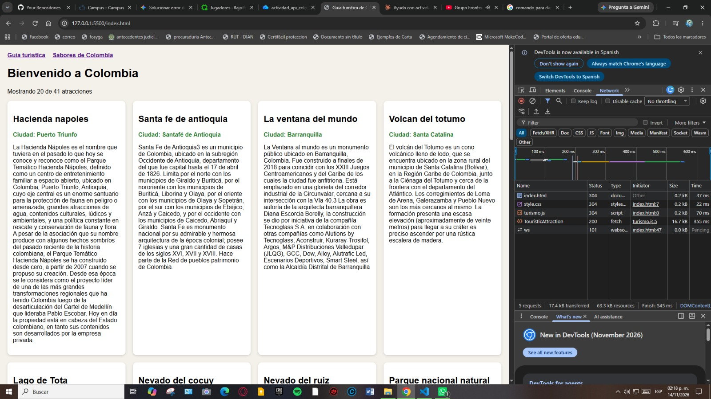
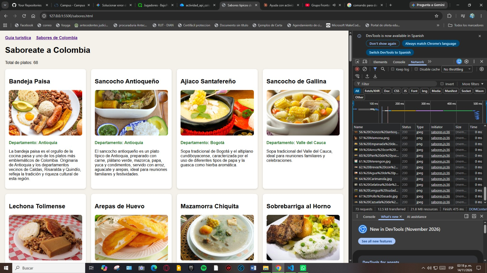

# Mini Portal de Colombia con API

## Descripción

Mini portal web informativo sobre Colombia que consume datos de la API pública [API Colombia](https://api-colombia.com/) y los muestra dinámicamente en el DOM con JavaScript.

El proyecto tiene dos páginas conectadas mediante hipervínculos:

- **Guía turística:** muestra las primeras 20 atracciones turísticas con su nombre, ciudad y descripción.
- **Sabores de Colombia:** muestra los 68 platos típicos con su nombre, imagen, departamento y descripción, además del total de platos.

Ambas páginas muestran un mensaje de carga mientras llegan los datos y un mensaje de error si la petición falla.

## Tecnologías usadas

- HTML5
- CSS3
- JavaScript (fetch, promesas y manipulación del DOM)
- API Colombia (`/api/v1/TouristicAttraction` y `/api/v1/TypicalDish`)
- Git y GitHub

## Instrucciones de uso

1. Clona el repositorio:
   ```bash
   git clone https://github.com/JohynerM/Johyner-Martinez-api-colombia.git
   ```
2. Abre la carpeta del proyecto en Visual Studio Code.
3. Abre `index.html` con la extensión **Live Server** (clic derecho → *Open with Live Server*).
4. Usa el menú de la parte superior para navegar entre **Guía turística** y **Sabores de Colombia**.

Se necesita conexión a internet para consultar la API.

## Estructura del proyecto

```
[nombre-apellido-api-colombia]/
├── index.html
├── sabores.html
├── style.css
├── JS/
│   ├── turismo.js
│   └── sabores.js
└── README.md
```

## Capturas



